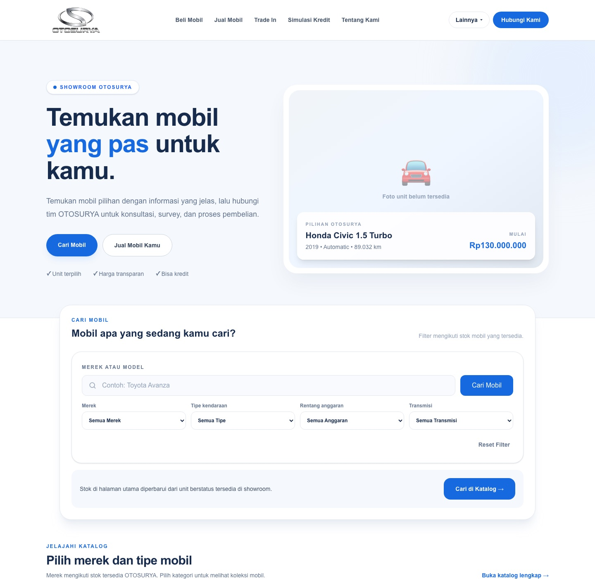
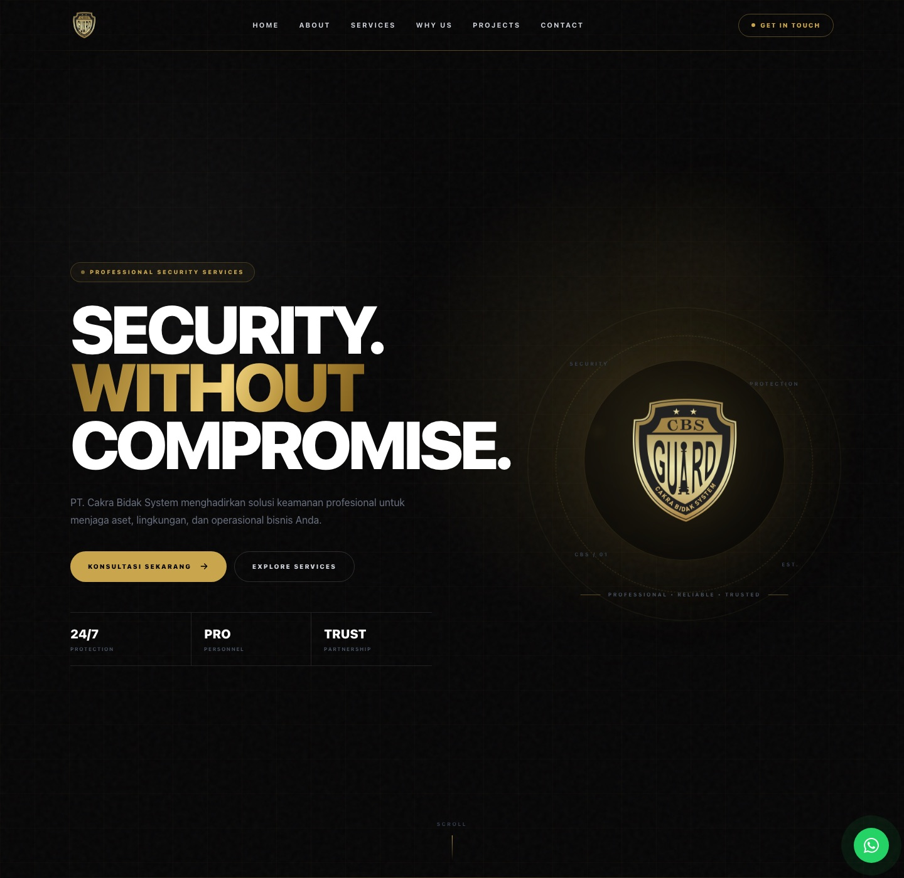

# Andhika Narada Putra — Portfolio

Personal portfolio for Andhika Narada Putra, a Full-Stack Developer focused on useful digital products, thoughtful interfaces, and the systems behind them.

## Featured projects

- **OTOSURYA** — Digital automotive showroom with vehicle listings and inventory-management functionality. Case-study route: `/projects/otosurya` (`src/app/projects/[slug]/page.tsx`).
- **CBS Guard** — Security services website with service content and administrative management. Case-study route: `/projects/cbs-guard` (`src/app/projects/[slug]/page.tsx`).

The project images included in this repository are genuine **local development captures** from the original project sources. They are not presented as production screenshots.





## Built with

- Next.js App Router and React
- TypeScript
- Tailwind CSS v4
- Biome for linting and formatting

## Run locally

Prerequisite: Node.js compatible with the installed Next.js version.

```bash
npm ci
npm run dev
```

Open `http://localhost:3000`.

The portfolio itself does not require project-specific environment variables. The optional sidebar portrait is served from `public/andhika-profile.jpg`; the AN. monogram appears if the image is unavailable.

## Routes

- `/` — Portfolio overview, selected work, About, Tech Stack, Contact, and footer
- `/projects/otosurya` — OTOSURYA case study
- `/projects/cbs-guard` — CBS Guard case study

## Checks

```bash
npm run lint
npx tsc --noEmit
npx next build --webpack
```
